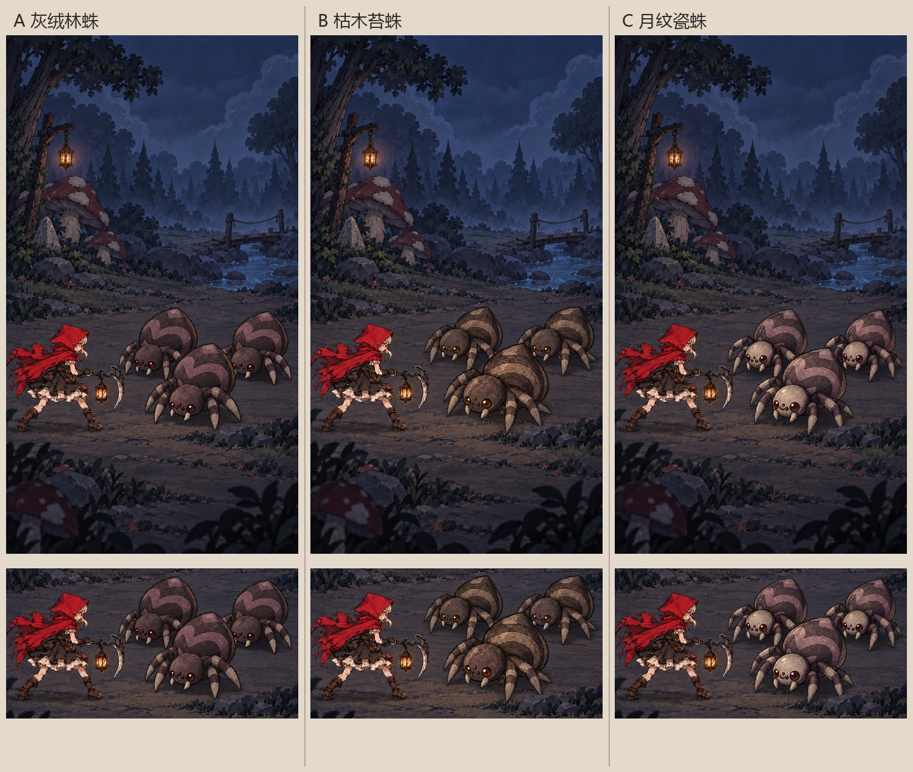
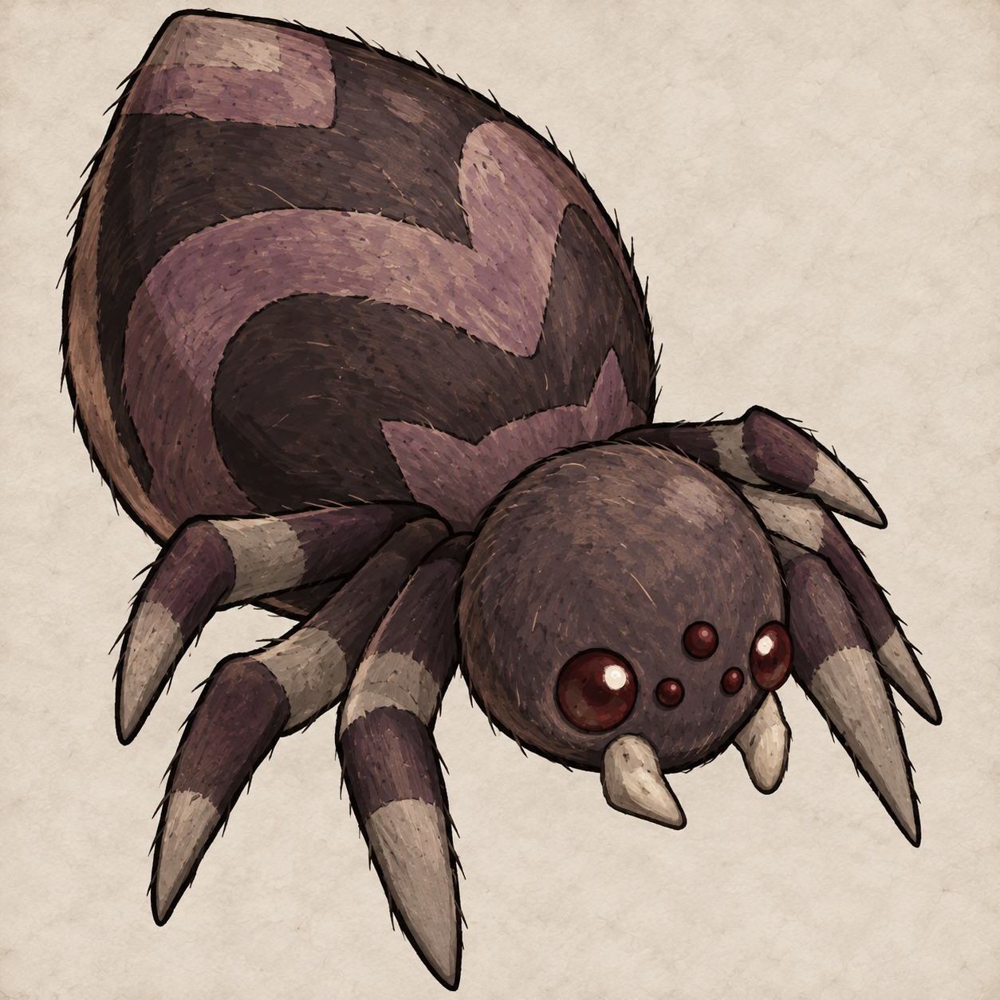

# C032_S01B 黑森林蜘蛛风格试制

## 三版本战斗场景候选（2026-10-11）

用户要求三个风格版本放入新战斗背景以供挑选。现已生成 A 灰绒林蛛、B 枯木苔蛛、C 月纹瓷蛛；名称仅用于比较，不代表已确认的正式怪物名。状态均为待选择。

| 候选 | 材质与配色 | 场景概念原图 | 完整提示词 |
| --- | --- | --- | --- |
| A 灰绒林蛛 | 深灰紫短绒、灰紫腹纹、暗红眼 | [A](variants/A-gray-velvet-battle-v1.png) | [A 提示词](variants/A-gray-velvet-prompt.txt) |
| B 枯木苔蛛 | 灰褐木纹、少量苔绿、琥珀眼 | [B](variants/B-moss-bark-battle-v1.png) | [B 提示词](variants/B-moss-bark-prompt.txt) |
| C 月纹瓷蛛 | 骨白脸部、灰紫腹纹、暗红眼 | [C](variants/C-moon-shell-battle-v1.png) | [C 提示词](variants/C-moon-shell-prompt.txt) |

沿用已授权的 imagegen CLI/API 路径，分别调用三次 gpt-image-2 edit；每次输入依次为第一章第二节蘑菇森林概念、原 C032_S01B、上一版蜘蛛概念。quality=high、请求尺寸 1008×1792、n=1、no-augment。实际返回三张均为 941×1672 RGB PNG，保留原文件。原始 API 输出在本地 `output/imagegen/c032-s01b/variants/`；设计参考副本及对比图保存在本目录 `variants/`。对比图由原图缩放与战斗区裁剪组成，未另行绘制蜘蛛。

三图以同一背景、小红帽和紧凑三角站位比较材质与可读性。人工已查看三张整图；A 更低调，B 与林地材质接近，C 脸部明度更高。实际生成的三只蜘蛛朝向偏正面，正式分件阶段仍需校准面向主角的侧向三分之四角度。当前只用于选择设计方向，不宣称严格复现原骨架、攻击姿态或生产贴图。

以上均为 AI 生成的场景概念图，不是 Unity 游戏截图；未改场景、Prefab、原 Spine 资源或波次，不记为 Unity 实景验收。

---

2026-10-11。状态：v1 概念图已生成并检查，待用户确认；尚未制作生产分件或接入 Unity。

## 来源与结构

- 原资源：`D:/Workspace/Spine/monster2/C032_S01B/`；整体参考：同级 `menu/C032_S01B.png`。
- 包含原生 `.spine`、JSON、atlas、图集及独立分件；保持原资源不变。
- JSON：30 骨骼、22 插槽。版本字符串为 `3.8-from-4.0-from-4.1-from-4.2.43`，不能仅据此认定兼容当前 Runtime；atlas 含 `bounds`、数值 `rotate` 和 `pma:true`，正式导入前需实测或转换。
- 原动画：Atk1_00、Death_00、GetUp_00、Hit_00、Idle_Battle_00、Idle_Down_00、KnockBack_00、KnockDown_00、Run_Battle_00、Stun_00。

## 初版美术方向

保留原三分之四视角、圆头、高耸腹部、三对分节腿、原眼部排列及独立口器。深色墨线与大块手绘明暗匹配现有蘑菇；亮紫青蓝改为低饱和灰紫褐，眼睛暗石榴红，口器旧骨白。腹部曲纹降为低对比灰紫纹，表面采用哑光甲壳与少量短绒质感。

以原有多眼和体态表达早期的轻微异常；不附加触手、邪眼纹章、蘑菇或新剧情身份。概念保持源朝向；正式战斗面向主角时在 Unity 显示节点翻转，不改骨骼及贴图内部方向。

## 下一步与边界

提示词见 `prompt-v1.txt`。用户明确授权后，使用 imagegen 技能的原版 `scripts/image_gen.py edit`，通过现有第三方中转的 Images API 调用 `gpt-image-2`。参数：quality=high、size=1024x1024、n=1、no-augment；以实际保存文件尺寸为准。未修改技能脚本或源 Spine 资源。

三张输入依次为原蜘蛛整体参考、蘑菇三怪 v4 材质与画风参考、第一章蘑菇森林场景。原 API 输出保存于本地 `output/imagegen/c032-s01b/concept-v1.png`，概念参考副本归档于本目录 `concepts/`。本图是设计参考，不是游戏截图或可直接使用的图集。

文件检查：中转实际返回 1254×1254 RGB PNG，与请求的 1024×1024 不同；已按原样保留，不将请求尺寸冒充实际尺寸。

人工查看：保留三分之四视角、大腹圆头、六条分节腿与原有眼部排列；灰紫褐与暗红配色、手绘纹理和墨线已经呈现。腹部曲纹与腿部浅色带仍较清晰，后续可依据用户反馈调整。当前为浅纸色背景，无透明分件；未进行动画与 Unity 实景验收。

先检查整体现稿与手机显示尺寸下的辨识度。正式换皮需覆盖眼睛表情、眼皮、全部腿段和口器等动画附件，保留原动画与绑定，补齐战斗别名和事件；通过预览与实际战斗后才能记为完成。新资源届时分配独立 Mob 编号，不覆盖任何原版资源。
