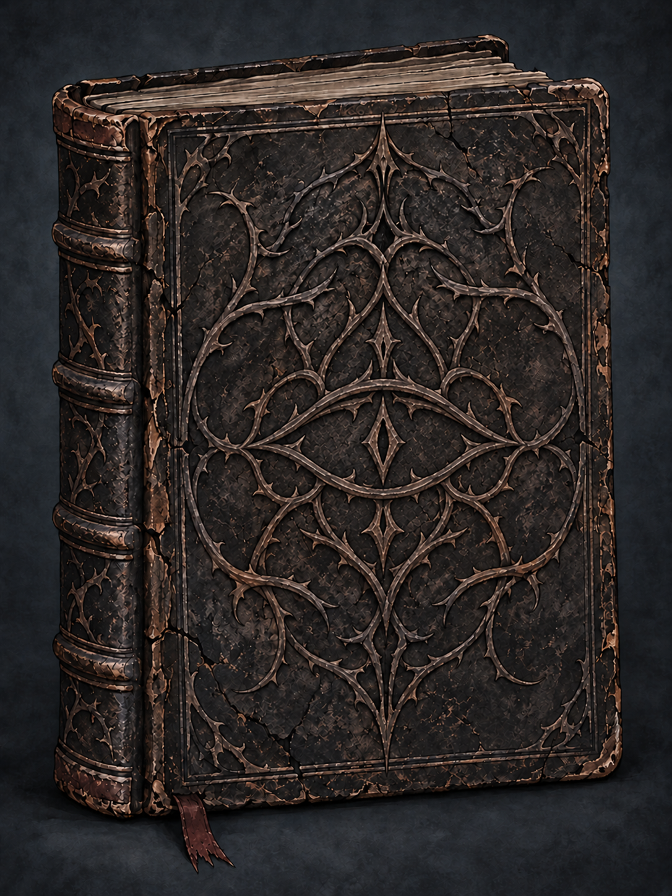

# 诅咒童话书 — 已确认设定

确认日期：2026-10-09。用户已确认 v4 邪眼封面，作为游戏设定保留。

## 正式视觉参考

- 正式参考：`cursed-book-approved.png`
- 生成提示词：`cover-prompt.txt`（内置 imagegen 生成）
- 原始版本：`../../output/imagegen/cursed-storybook-v4/cursed-book-evil-eye.png`

## 书与游戏的关系

游戏围绕一本非常古老的诅咒童话书展开，小红帽穿梭不同世界的历险在书中呈现。整体融合黑暗童话、上古邪神、多维世界、猎奇与轻微恐怖。

开场聚焦这本书；翻开后呈现小红帽的基础能力与主界面；开始战斗时翻到战斗场景页；其他页面承载其他功能与剧情介绍。具体翻页交互与内页布局尚未定稿。

## 已确认的封面规则

- 书是古老、深邃、令人不安的诅咒之物；封面不出现小红帽或其他主角形象，不出现城堡、森林等故事背景插画，不做游戏宣传画式封面。
- 以黑褐色龟裂旧皮革、磨损书脊、厚重灰旧书页和暗色荆棘纹样表现年代感。
- 中央为邪眼纹章：横向眼形轮廓与抽象菱形瞳心，融入周围荆棘纹样。
- 邪眼仅通过同材质压纹和纹路表达，不能画成真实眼球；保持抽象、古老封印般的质感。
- 采用已确认图中的无书名封面与克制配色。诡异感来自纹样和材质。
- “斜眼”是用户输入笔误，已更正为“邪眼”；v3 斜置纹章不是最终设定。

## 与战斗 UI 的衔接

“UI 设计”会话已确认 B3「诅咒童话」方向：灰旧纸页、黑色荆棘墨绘、城堡剪影、暗红蜡封。内页与 UI 可沿用这套绘本语言，封面遵循上述独立约束，不将场景插画搬到封面。

本次确认范围为书的整体概念及 v4 封面。早期概念中的展开内页仅为探索稿，尚未确认。

## 启动动画实现（2026-10-12）

按用户要求，以邪眼诅咒书的 Spine 翻开动画替换旧鲨鱼 Logo 启动页。实现与可编辑资源见 [SpineSource/README.md](SpineSource/README.md)。Gameplay 场景使用持久化 UGUI Prefab，旧启动对象保留并停用。

制作中从批准封面派生了正面透明封皮，保留邪眼、荆棘与旧皮革特征。动画采用正面翻书视角，区别于概念图的三分之四视角；新增的空白内页是启动动画辅助素材，尚不代表主界面或剧情页的最终设计。没有将这两项技术适配记作用户批准的新概念稿，也不宣称逐像素还原原图。

用户进一步明确启动演出：先展示书，翻开并翻页时镜头前推，停页后真实主界面逐渐浮现，直至书页铺满屏幕，无缝交接。现已按此流程实现，正常动画时长约 6.8 秒。主界面提前加载并实时渲染到右页，交接时恢复原界面及操作；加载较慢时停在打开状态等待。此项为用户明确提出的启动流程调整，封面规则不变。

用户进一步指定：翻书段保持时长，但增加连续翻过的书页；画面显现应像魔法书隐藏文字被唤醒，以洇墨扩散替代均匀淡入。实现为八张接续翻页与多点纸面洇墨显影。

最新节奏调整：翻开和翻页时不推进镜头，中心固定于右页；主界面先完全洇开，短暂停留后再推进到全屏。当前正常演出约 8.9 秒，替代上一版显影与推进同时进行的节奏。

按用户提供的中间构图截图进一步调整：翻书期间缓慢推近，让右页主界面画幅占屏幕高度约 65%，保留纸边和封皮；在该位置等洇墨显影完成，再继续推近到全屏。右页持续居中，保留 8.9 秒整体演出时长。

硬封皮优化：经用户授权增加板芯厚度、皮革书脊牵动、接触阴影及有重量的开合节奏，继续使用现有封面美术和 Spine 实现；保留纸页翻动及已确认的镜头节奏。

用户确认场景与操作界面分离：书页上只显现小红帽与庇护所，插画固定 3:4 构图；镜头进入场景后，操作界面逐渐出现。该流程替代此前把完整主界面显示在书页上的方案，保留翻书与洇墨效果。

用户确认取消双重运动：推进时场景构图固定，只保留镜头移动，主界面背景沿用推进终点取景。同时将插画矩形硬边改为不规则、可透出底层纸纹的洇染边缘，增强画在纸上的感觉。
